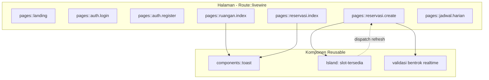

# Roadmap Pengembangan RuangKita

## Kondisi Proyek Saat Ini

Proyek di [`d:\Informatika\Sem 4\Pemrograman Web II\ruangkita`](d:\Informatika\Sem 4\Pemrograman Web II\ruangkita) sudah memiliki:

- Laravel **13.8**, Livewire **4.3**, Tailwind **4**, PHP **^8.3**
- Layout dasar [`resources/views/layouts/app.blade.php`](resources/views/layouts/app.blade.php) dengan `@livewireStyles` / `@livewireScripts`
- Konfigurasi Livewire SFC di [`config/livewire.php`](config/livewire.php) (`type: sfc`, namespace `pages::`)
- Migration default `users` saja — **belum ada fitur bisnis**

Tidak perlu commit ulang setup dasar; mulai dari migration domain.

---

## Desain Database & Relasi

```mermaid
erDiagram
    users ||--o{ reservasi : membuat
    ruangan ||--o{ fasilitas : memiliki
    ruangan ||--o{ reservasi : dipesan

    users {
        bigint id PK
        string name
        string email
        string password
        enum role "admin|pemohon"
        string nim_nip nullable
        string foto nullable
    }

    ruangan {
        bigint id PK
        string nama
        int kapasitas
        string foto nullable
        time jam_buka default 07:00
        time jam_tutup default 21:00
    }

    fasilitas {
        bigint id PK
        bigint ruangan_id FK
        string nama
    }

    reservasi {
        bigint id PK
        bigint ruangan_id FK
        bigint user_id FK
        date tanggal
        time jam_mulai
        time jam_selesai
        enum status "menunggu|disetujui|ditolak"
        text keterangan nullable
    }
```

**Keputusan desain:**
- `User` = pemohon (dosen/mahasiswa); kolom `role` membedakan admin vs pemohon
- `fasilitas` tabel terpisah (bukan kolom JSON) agar `Ruangan hasMany Fasilitas` jelas
- `jam_buka` / `jam_tutup` di `ruangan` untuk nilai tambah pembatasan jam operasional

---

## Arsitektur Livewire 4



**Fitur Livewire 4 wajib (minimal 2+, target 4):**

| Fitur LW4 | Dipakai di |
|-----------|------------|
| Single-file `.wire.php` | Semua halaman (`pages::...`) |
| **Island** | Panel "Slot Tersedia Hari Ini" di form reservasi |
| **Slots** | Layout toast (`<x-slot:icon>`) |
| **dispatch / #[On]** | Toast global + refresh island setelah simpan reservasi |
| `wire:model.live` | Form reservasi (validasi bentrok realtime) |

---

## Fase & Urutan Commit (Satu Fitur = Satu Commit)

### Fase 1 — Fondasi Data

**Commit 1 — `feat: add migrations for ruangan, fasilitas, reservasi and extend users`**
- Migration: `ruangan`, `fasilitas`, `reservasi`
- Alter `users`: tambah `role`, `nim_nip`, `foto`
- Index komposit di `reservasi(ruangan_id, tanggal, jam_mulai, jam_selesai)` untuk query bentrok

**Commit 2 — `feat: add eloquent models with relationships`**
- Model: [`app/Models/Ruangan.php`](app/Models/Ruangan.php), `Fasilitas`, `Reservasi`
- Update [`app/Models/User.php`](app/Models/User.php): `hasMany(Reservasi)`, helper `isAdmin()`
- Cast enum `status`, `role`

---

### Fase 2 — UI Dasar & Autentikasi

**Commit 3 — `feat: add app layout with navigation and landing page`**
- Perluas layout: navbar, footer, area konten
- Halaman landing `pages::landing` (deskripsi RuangKita, CTA login/register)
- Route `Route::livewire('/', 'pages::landing')`

**Commit 4 — `feat: implement login and register with livewire`**
- `pages::auth.login` dan `pages::auth.register` (SFC `.wire.php`)
- Validasi Livewire + `wire:model.live` pada email/password
- Redirect setelah login ke dashboard

**Commit 5 — `feat: protect routes with auth and role middleware`**
- Middleware `EnsureUserIsAdmin` untuk CRUD ruangan & persetujuan
- Grup route: guest (login/register), auth (reservasi, jadwal), admin (ruangan, approval)
- Halaman dashboard sederhana per role

---

### Fase 3 — Data Awal & Notifikasi

**Commit 6 — `feat: add database seeders for users, ruangan, and reservasi`**
- `DatabaseSeeder` + `UserSeeder`, `RuanganSeeder`, `ReservasiSeeder`
- 1 admin, beberapa pemohon, 5+ ruangan dengan fasilitas, sample reservasi

**Commit 7 — `feat: add global toast notification component with livewire events`**
- Komponen `components::toast` dengan **slots** (ikon/success/error)
- Listener `#[On('notify')]` — dipanggil via `$this->dispatch('notify', ...)` dari komponen CRUD
- Integrasikan ke layout

---

### Fase 4 — CRUD Ruangan (+ Search/Filter/Pagination)

**Commit 8 — `feat: add ruangan CRUD with search filter and pagination`**
- `pages::ruangan.index` — daftar ruangan, **pagination 10**
- `wire:model.live` untuk search (nama) + filter (kapasitas min)
- `pages::ruangan.form` — create/edit (nama, kapasitas, jam operasional)
- Admin only

**Commit 9 — `feat: add ruangan photo upload with livewire file upload`**
- Field `foto` di form ruangan: `WithFileUploads`, validasi `image|max:2048`
- Preview foto, simpan ke `storage/app/public/ruangan`
- `php artisan storage:link` — dokumentasikan di README nanti

**Commit 10 — `feat: manage fasilitas per ruangan`**
- Sub-form atau modal di halaman edit ruangan untuk CRUD fasilitas
- Relasi `hasMany` ditampilkan & dikelola tanpa halaman terpisah (cukup untuk soal)

---

### Fase 5 — Data Pemohon

**Commit 11 — `feat: add pemohon user management for admin`**
- `pages::admin.pemohon.index` — daftar user role pemohon
- Tampilkan nama, email, NIM/NIP; admin bisa lihat profil
- (Opsional ringan: edit profil sendiri untuk pemohon)

---

### Fase 6 — Reservasi (Inti Soal)

**Commit 12 — `feat: add reservasi form with realtime schedule conflict validation`**
- `pages::reservasi.create` dengan `wire:model.live` pada `ruangan_id`, `tanggal`, `jam_mulai`, `jam_selesai`
- Custom rule `App\Rules\NoJadwalBentrok` — cek irisan waktu pada ruang & tanggal sama
- Pesan error realtime di bawah field jam
- Validasi jam operasional ruangan

**Commit 13 — `feat: add island component for available slots today`**
- Komponen Island `components::slot-tersedia` — refresh independen saat ruang/tanggal berubah
- Tampilkan slot kosong vs terisi hari ini
- `#[Isolate]` atau directive Island LW4 sesuai dokumentasi v4

**Commit 14 — `feat: add reservasi list with status filter and pagination`**
- `pages::reservasi.index` — pemohon lihat milik sendiri, admin lihat semua
- Filter status (`menunggu|disetujui|ditolak`), search nama ruang, pagination 10
- Aksi: detail, batalkan (jika masih menunggu)

**Commit 15 — `feat: add reservasi approval workflow for admin`**
- Tombol setujui/tolak di daftar reservasi (admin)
- Update status + `dispatch('notify')` + refresh island jika perlu
- Validasi ulang bentrok saat approve (cegah race condition)

---

### Fase 7 — Jadwal & Dokumentasi

**Commit 16 — `feat: add daily schedule view per ruangan`**
- `pages::jadwal.harian` — pilih tanggal + ruangan (`wire:model.live`)
- Tabel/grid slot per jam dengan warna status (kosong / menunggu / disetujui)
- Akses: semua user terautentikasi

**Commit 17 — `docs: add README with features, requirements, and installation steps`**
- Ganti [`README.md`](README.md) default Laravel
- Isi: deskripsi RuangKita, daftar fitur, PHP/MySQL requirement, langkah `clone → composer install → npm install → .env → migrate --seed → storage:link → serve`

---

## Pemetaan ke Spesifikasi Penugasan

| Requirement | Commit yang menutupi |
|-------------|---------------------|
| Autentikasi + middleware | 4, 5 |
| Model + migration + relasi | 1, 2 |
| CRUD Livewire | 8, 10, 11, 14 |
| Validasi realtime | 4, 8, 12 |
| Search/filter/pagination | 8, 14 |
| Upload foto | 9 |
| LW4 (SFC, Island, slots, dispatch) | 7, 12, 13 |
| Seeder | 6 |
| Notifikasi UI | 7 (+ dipakai di 8–16) |
| README | 17 |
| Validasi bentrok jadwal | 12, 15 |
| Status + approval | 14, 15 |
| Jadwal harian | 16 |

---

## Commit Bonus (Opsional, +Poin)

**Commit 18 — `feat: add weekly calendar view`**
- Grid 7 hari dengan blok reservasi per ruangan

**Commit 19 — `feat: send email notification when reservasi approved`**
- Mailable + queue/notifikasi Laravel saat status → `disetujui`

**Commit 20 — `feat: enforce ruangan operating hours in validation`**
- Sudah direncanakan di Commit 12; commit terpisah jika ingin menonjolkan fitur bonus

---

## Struktur File yang Akan Dibuat

```
app/
  Models/          Ruangan, Fasilitas, Reservasi (+ update User)
  Rules/           NoJadwalBentrok.php
  Http/Middleware/ EnsureUserIsAdmin.php
resources/views/
  layouts/         app.blade.php (diperluas)
  pages/           landing, auth/*, ruangan/*, reservasi/*, jadwal/*, admin/*
  components/      toast, slot-tersedia (.wire.php)
database/
  migrations/      create_ruangan, fasilitas, reservasi, add_role_to_users
  seeders/         User, Ruangan, Reservasi
routes/
  web.php          Route::livewire(...) groups
```

---

## Tips Eksekusi

1. **Jalankan `php artisan migrate` setelah Commit 1**, lalu `--seed` setelah Commit 6
2. **Setiap commit**: pastikan aplikasi masih bisa dijalankan (`php artisan serve` + `npm run dev`)
3. **Pesan commit**: gunakan format `feat:`, `docs:`, `fix:` — konsisten dan deskriptif
4. **Testing manual per commit**: cek fitur yang baru ditambah sebelum lanjut ke commit berikutnya
5. **Urutan penting**: seeder (6) sebelum CRUD ruangan (8) agar ada data untuk ditampilkan saat demo

---

## Estimasi Waktu

| Fase | Commit | Estimasi |
|------|--------|----------|
| Fondasi data | 1–2 | 2–3 jam |
| UI & auth | 3–5 | 3–4 jam |
| Seeder & toast | 6–7 | 2 jam |
| CRUD ruangan | 8–10 | 4–5 jam |
| Pemohon | 11 | 1–2 jam |
| Reservasi | 12–15 | 5–6 jam |
| Jadwal & README | 16–17 | 2–3 jam |
| **Total wajib** | **17 commit** | **~20–25 jam** |
